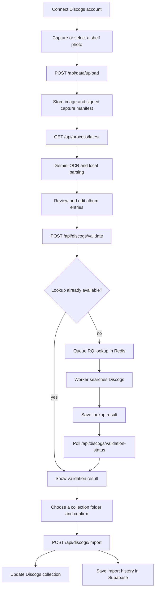

# SpineScan

SpineScan turns photos of CD shelves into editable album matches and helps add them to a Discogs collection.

## User workflow

1. **Connect Discogs.** The frontend starts OAuth with `GET /api/auth/request_token`; the user authorizes SpineScan on Discogs. The callback and access-token exchange complete the flow. The Flask session cookie holds an opaque auth-session ID and username; the Discogs tokens are stored in Redis with an expiration.
2. **Capture and upload.** The frontend uploads a JPEG, PNG, or WebP to `POST /api/data/upload`. The API validates and compresses the image, stores it in Supabase Storage, and records a signed capture manifest in Supabase Postgres.
3. **Run OCR.** The frontend calls `GET /api/process/latest` for that capture. The API verifies ownership and the capture signature/checksum, reads the image, and runs Gemini OCR synchronously in the API request. It tries `gemini-3.5-flash-lite`, then `gemini-3.8-flash`, then `gemini-3.6-flash` if an earlier tier returns no usable result. Each model gets one retry after a 1-second delay for a 503 response. The frontend parses the returned lines into artist/title entries; the user can review and edit them.
4. **Validate and match.** The user starts validation from Review with `POST /api/discogs/validate`. Lookup resolution checks durable album data in Supabase and transient result/pending state in Redis. Cache misses are queued as RQ jobs when a worker is available. The worker searches Discogs and stores lookup results in Supabase and the Redis result cache; when workers are unavailable, a synchronous fallback may run if enabled. The frontend checks pending entries through `POST /api/discogs/validation-status`.
5. **Choose a folder and import.** The frontend loads collection folders from Discogs. Once entries are valid, the user confirms the import. `POST /api/discogs/import` uses an idempotency lock, warms the collection-membership cache, checks duplicates by release ID and album identity, and adds eligible releases to Discogs. The API writes the import summary to the Supabase `imports` table.
6. **Clean up and view history.** Capture cleanup is queued after OCR when `DELETE_CAPTURE_AFTER_PROCESS` is enabled (default); the import screen also requests best-effort finalization. Import results are shown in the UI and can be retrieved from the durable import-history table.

## Architecture and data

- **Frontend:** React + Vite. It calls the Flask API with authenticated session cookies and keeps the in-progress scan/review state in React context.
- **Flask API:** Handles Discogs OAuth, image upload and OCR, validation, collection folders, imports, and history. Gemini OCR is request-time work; it does not run in the RQ worker.
- **RQ worker:** Processes asynchronous Discogs lookup and capture-cleanup jobs from Redis.
- **Redis:** Holds the RQ queue and other transient state, including OAuth/auth-session data, lookup pending/result markers, rate limits, circuit-breaker state, and import idempotency state. Redis is not durable; a restart can lose queued jobs and sessions.
- **Supabase Postgres:** Stores capture manifests, durable album lookup data, collection-membership cache data, and import history.
- **Supabase Storage:** Stores uploaded capture images until cleanup.
- **External APIs:** Discogs provides OAuth, release matching, and collection operations. Gemini processes shelf images. Temporary image processing uses the API container's filesystem; it is not persistent storage.

### Redis on Fly.io

The API and worker use the private `ye-spinescan-redis.internal` address in `iad`. The Redis app has one 512 MB machine, a 256 MB `maxmemory` limit, and the `noeviction` policy. It has no volume, RDB snapshots, or AOF persistence. Redis restarts can therefore lose queued jobs and transient state; users may need to reconnect Discogs if their Redis-backed auth session is lost. Supabase is the durable store for capture, lookup, collection-cache, and import records.

The Redis password is provided through Fly secrets, not stored in the repository. Both apps use a `REDIS_URL` of the form `redis://default:<password>@ye-spinescan-redis.internal:6379/0`. The code still recognizes `UPSTASH_REDIS_URL` as a fallback only when `REDIS_URL` is unset; production uses the private Fly URL.

See [`fly.redis.toml`](fly.redis.toml) and [`Dockerfile.redis`](Dockerfile.redis) for the Redis app configuration.

## Polling and operational endpoints

- **Validation:** Poll delays start at 1 second, grow by 1.5x to a 10-second cap, and include 10% jitter. After 20 polls the UI displays a waiting warning and continues checking every 15 seconds while entries remain pending; this is not a hard timeout.
- **Import:** When the import request is still in progress or times out, the frontend checks `POST /api/discogs/import-status` every 5 seconds for up to 72 attempts (roughly 6 minutes, plus request latency). If it still cannot confirm completion, the UI asks the user to check the collection before retrying.
- **Health probes:** `GET /healthz` returns basic API health without querying Redis. `GET /readyz` checks Redis, Supabase, and lookup-worker status; `GET /metrics` reads queue statistics. These endpoints perform work when called; the repository does not configure a periodic pinger.

## Repository layout

- [`frontend`](frontend): React application.
- [`backend`](backend): Flask API, routes, services, OCR code, and RQ worker.
- [`backend/sql/captures.sql`](backend/sql/captures.sql): Capture manifest table migration.
- [`backend/sql/discogs_collection_cache.sql`](backend/sql/discogs_collection_cache.sql): Durable per-folder Discogs membership cache migration.
- [`backend/sql/imports.sql`](backend/sql/imports.sql): Import history table migration.
- [`TESTING.md`](TESTING.md): Local test and build instructions.
