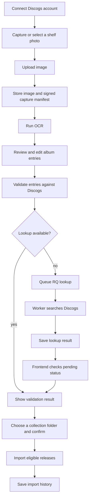

# SpineScan

SpineScan turns photos of CD shelves into editable album matches and helps add them to a Discogs collection.

## User workflow

1. **Connect Discogs.** The frontend starts OAuth with `GET /api/auth/request_token`; the user authorizes SpineScan on Discogs. The callback and access-token exchange complete the flow. Discogs tokens are held in expiring session state; the browser session stores an opaque session identifier.
2. **Capture and upload.** The frontend uploads a JPEG, PNG, or WebP image to `POST /api/data/upload`. The API validates and compresses it, stores the image in Supabase Storage, and records a signed capture manifest in Supabase Postgres.
3. **Run OCR.** The frontend asks `GET /api/process/latest` to process the capture. The API verifies ownership and the capture signature/checksum, reads the image, and runs Gemini OCR synchronously. It tries `gemini-3.5-flash-lite`, then `gemini-3.8-flash`, then `gemini-3.6-flash` if an earlier tier returns no usable result. Each model gets one retry after a 1-second delay for a 503 response. The frontend parses the returned lines into artist/title entries for review and editing.
4. **Validate and match.** The user starts validation from Review. The API checks durable album data in Supabase and transient result/pending state in Redis. Cache misses are queued for an RQ worker when available; the worker searches Discogs and stores lookup results. If workers are unavailable, a synchronous fallback may run when enabled. The frontend checks pending entries until they resolve.
5. **Choose a folder and import.** The frontend loads collection folders from Discogs. After entries are valid, the user confirms the import. The API uses an idempotency lock, warms collection-membership data, checks duplicates by release ID and album identity, and adds eligible releases to Discogs.
6. **Clean up and view history.** Capture cleanup is queued after OCR when `DELETE_CAPTURE_AFTER_PROCESS` is enabled (default); the import screen also requests best-effort finalization. Import results are stored in Supabase and shown in the UI.

## Architecture and data

- **Frontend:** React + Vite. It calls the Flask API with authenticated session cookies and keeps in-progress scan/review state in React context.
- **Flask API:** Handles Discogs OAuth, image upload and OCR, validation, collection folders, imports, and history. Gemini OCR runs during the API request; it does not run in the RQ worker.
- **RQ worker:** Processes asynchronous Discogs lookup and capture-cleanup jobs.
- **Redis:** Provides the RQ queue and transient cache/session coordination. It is not durable; a restart can interrupt queued work and require users to reconnect.
- **Supabase Postgres:** Stores capture manifests, durable album lookup data, collection-membership cache data, and import history.
- **Supabase Storage:** Stores uploaded capture images until cleanup.
- **External APIs:** Discogs provides OAuth, release matching, and collection operations. Gemini processes shelf images. Temporary image processing uses the API container's filesystem and is not persistent storage.

## Polling and operational endpoints

- **Validation:** Poll delays start at 1 second, grow by 1.5x to a 10-second cap, and include 10% jitter. After 20 polls the UI displays a waiting warning and continues checking every 15 seconds while entries remain pending; this is not a hard timeout.
- **Import:** When an import is still in progress or its request times out, the frontend checks status every 5 seconds for up to 72 attempts (roughly 6 minutes, plus request latency). If completion is still unconfirmed, the UI asks the user to check the collection before retrying.
- **Health probes:** `GET /healthz` returns basic API health without querying Redis. `GET /readyz` checks Redis, Supabase, and lookup-worker status; `GET /metrics` reads queue statistics. These endpoints perform work when called; the repository does not configure a periodic pinger.

## Repository layout

- [`frontend`](frontend): React application.
- [`backend`](backend): Flask API, routes, services, OCR code, and RQ worker.
- [`backend/sql/captures.sql`](backend/sql/captures.sql): Capture manifest table migration.
- [`backend/sql/discogs_collection_cache.sql`](backend/sql/discogs_collection_cache.sql): Durable per-folder Discogs membership cache migration.
- [`backend/sql/imports.sql`](backend/sql/imports.sql): Import history table migration.
- [`TESTING.md`](TESTING.md): Local test and build instructions.
